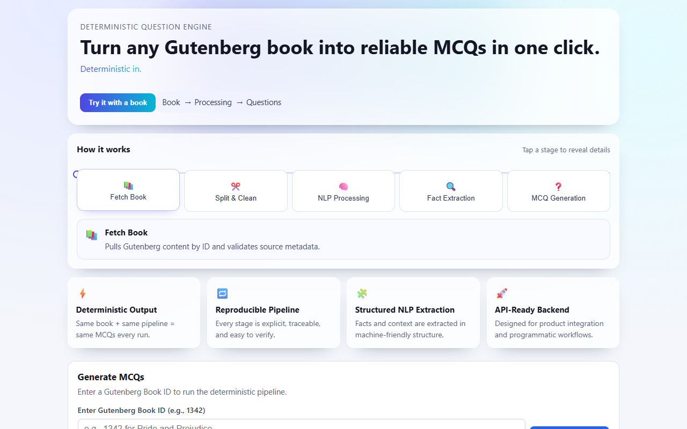
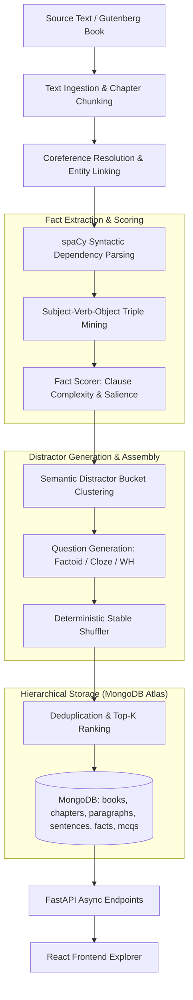

# Deterministic Question Engine

> NLP assessment engine that synthesizes structurally validated multiple choice questions from raw documents using dependency parsing, coreference resolution, and semantic distractor pooling.

[](https://www.python.org/)
[](https://fastapi.tiangolo.com/)
[](https://spacy.io/)
[](https://www.mongodb.com/)
[](https://react.dev/)

---

## Overview

Most LLM-based question generators hallucinate details, produce ambiguous options, or give different questions each time. For academic testing and reading assessments, questions need to be consistent and directly verifiable from source text.

I built this engine to generate assessments using rule-grounded NLP and dependency parsing:
- **Syntactic Fact Extraction**: Parses sentences into Subject-Verb-Object (SVO) trees with spaCy to extract grounded facts.
- **Coreference Resolution**: Replaces ambiguous pronouns across paragraphs so questions are self-contained.
- **Categorical Distractor Pooling**: Generates distractors by clustering entities of the same semantic class within the text.
- **Deterministic Shuffling**: Hashes option orders so assessment keys remain reproducible.

---

## Demo



---

## Pipeline



---

## Key Highlights

- **Syntactic SVO Mining**: Evaluates grammatical dependency trees (`nsubj`, `dobj`, `pobj`, verb predicates) and reconstructs active/passive voice transformations into clean questions.
- **Contextual Distractors**: Named Entity Recognition (NER) groups candidates into semantic buckets (`PERSON`, `ORG`, `GPE`, `DATE`, `NORP`) sampled from the same chapter to ensure distractors are plausible yet mutually exclusive.
- **Reproducible Hashes**: Option ordering is computed using stable hashing on `fact_id` and `variant_seed`.
- **Granular Lineage**: Data is structured across MongoDB collections (`books` -> `chapters` -> `paragraphs` -> `sentences` -> `facts` -> `mcqs`) so any question traces back to its exact sentence.

---

## Tech Stack

- **Backend**: Python 3.11, FastAPI, Uvicorn
- **NLP**: spaCy (`en_core_web_sm`), custom dependency tree traversal
- **Database**: MongoDB Atlas, PyMongo
- **Concurrency**: Python `ProcessPoolExecutor` for CPU-bound NLP parsing
- **Frontend**: React 18, Vite, Tailwind CSS

---

## Quickstart

### 1. Backend Setup
```bash
cd server
python -m venv .venv

# Windows:
.venv\Scripts\Activate.ps1
# Linux/macOS:
# source .venv/bin/activate

pip install -r requirements.txt
python -m spacy download en_core_web_sm
```

### 2. Environment Variables
Create `.env` inside `server/`:
```ini
MONGO_URI=mongodb://127.0.0.1:27017/qna_engine
PORT=10000
MCQ_RETURN_LIMIT=10
MCQ_TARGET=100
LOG_LEVEL=INFO
```

### 3. Start API Server
```bash
uvicorn server.main:app --host 0.0.0.0 --port 10000 --reload
```
API docs available at `http://localhost:10000/docs`.

### 4. Start Frontend
```bash
cd frontend
npm install
npm run dev
```

---

## Endpoints

| Method | Endpoint | Description |
| :--- | :--- | :--- |
| `GET` | `/health` | Health check & MongoDB status |
| `POST` | `/generate` | Start background extraction job for a `book_id` |
| `GET` | `/status/{book_id}` | Check processing progress |
| `GET` | `/mcqs/{book_id}` | Fetch generated MCQs with source sentence lineage |
